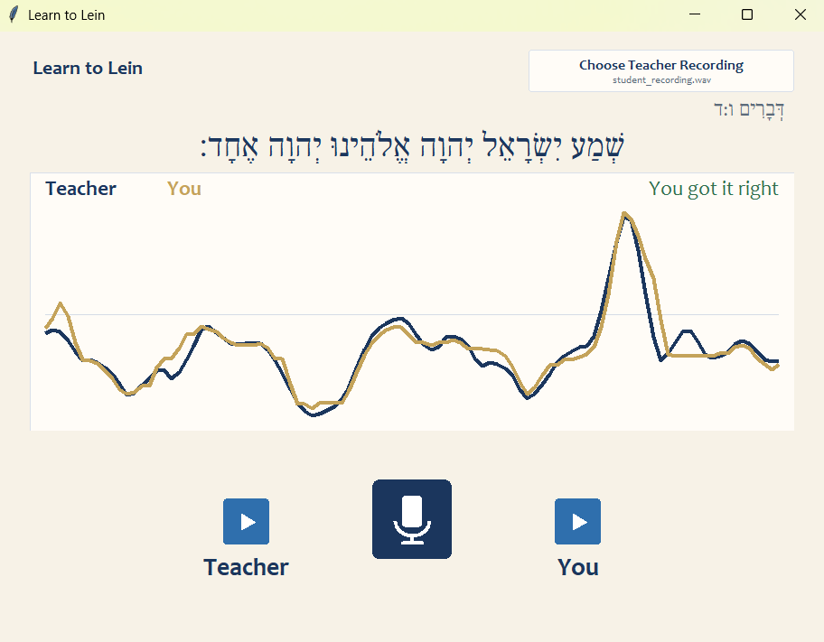

### Learn to Lein App

Learn to Lein helps users practice leining with the correct trop
(cantillation). It is designed especially for Orthodox Jewish
boys learning to read their bar mitzvah parshah.

The app takes a recording of a teacher reading a pasuk, records the student
reading the same pasuk, and compares the student's trop to the teacher's. It
then shows the two pitch lines and gives simple feedback on whether the trop
matches.

### Screenshots

### Links

- [Python](https://www.python.org/)
- [Tkinter](https://docs.python.org/3/library/tkinter.html)
- [NumPy](https://numpy.org/)
- [sounddevice](https://python-sounddevice.readthedocs.io/)
- [librosa](https://librosa.org/) (pitch tracking with [pyin](https://librosa.org/doc/latest/generated/librosa.pyin.html) and alignment with [DTW](https://librosa.org/doc/latest/generated/librosa.sequence.dtw.html))
- [Frank Ruhl Libre](https://github.com/fontef/frankruhllibre) (bundled Hebrew UI font, SIL OFL)
- [SIL Open Font License](https://openfontlicense.org/)
